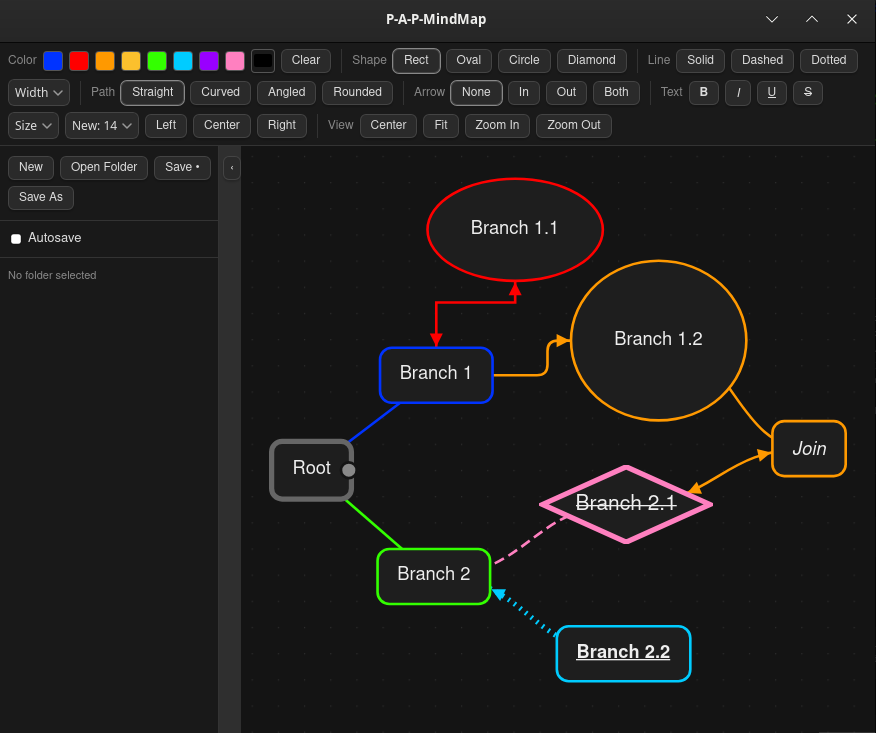

# Pick A Path - Mind Map

Keyboard-driven desktop mind-mapping app. Infinite canvas, cards linked by edges that always connect center to center, fast keyboard navigation.

<!-- Add a screenshot: put it in docs/screenshot.png and uncomment the next line -->


Built with [Tauri v2](https://tauri.app), React, [React Flow](https://reactflow.dev) and TypeScript. Developed and used on Linux (Arch, KDE Plasma, Wayland).

## Features

- Cards on an infinite canvas, with shapes: rectangle, oval, circle, diamond
- Per-card text styling: bold, italic, underline, strikethrough, font size, alignment
- Edge styling: solid / dashed / dotted, width, straight / curved / angled / rounded paths, arrowheads
- Colors cascade down a branch; cards with a manually chosen color are left alone
- Copy / paste whole branches, undo / redo, search and replace
- Folder sidebar for browsing `.canvas` files, optional autosave, last file and folder restored on launch
- Opens and saves [JSON Canvas](https://jsoncanvas.org) (`.canvas`), so files also open in Obsidian Canvas
- Imports SimpleMind `.smmx` maps

## Install

### Arch Linux (AUR)

```bash
yay -S pap-mindmap-git
```

### Build from source

Arch prerequisites:

```bash
sudo pacman -S --needed webkit2gtk-4.1 base-devel curl wget file openssl \
  appmenu-gtk-module libappindicator-gtk3 librsvg nodejs npm rust
```

Other distributions: see the [Tauri prerequisites](https://v2.tauri.app/start/prerequisites/#linux).

```bash
git clone https://github.com/PickAPathGames/PickAPath-Mindmap.git
cd PickAPath-Mindmap
npm ci
npm run tauri dev                      # run in development
npm run tauri build -- -b deb          # release build (binary: src-tauri/target/release/PAP-MindMap)
```

## Usage

### Mouse

| Action | Result |
|---|---|
| Double-click empty canvas | New card there (linked to the selected card, if any) |
| Double-click a card | Edit its text |
| Drag from the dot on a selected card | Connect to another card |
| Hold the mouse on a card (~0.35 s), or Shift+drag | Select the card and its whole branch, then drag to move it |
| Ctrl+click | Add to selection |
| Ctrl+drag on empty canvas | Box select |
| Right-click a toolbar button | Set it as the default for new cards / lines (shape, path, arrow, bold, italic, underline, strikethrough, size, alignment) |
| Right-click a color swatch or Clear | Select every card with that color |

### Keyboard

| Combo | Selection empty | Selection non-empty |
|---|---|---|
| Arrow | pan small | move small |
| Shift+Arrow | pan large | move large |
| Ctrl+Arrow | pan small (always) | pan small (always) |
| Ctrl+Shift+Arrow | pan large (always) | pan large (always) |
| Alt+Arrow | select nearest card that direction | same, anchored on selected card |
| Alt+Shift+Arrow | select farthest card that direction | same |
| Enter | new unlinked card, screen center | new card linked to selection, screen center (unlinked if 2+ selected) |
| Shift+Enter | new unlinked card, screen center (always) | same |

| Key | Action |
|---|---|
| F2 | Edit the selected card |
| Enter (while editing) | Finish editing |
| Shift+Enter (while editing) | New line in the card |
| Delete / Backspace | Delete selection |
| Esc | Deselect / close search |
| Home | Center the map |
| Ctrl+N / Ctrl+O | New / open |
| Ctrl+S / Ctrl+Shift+S | Save / save as |
| Ctrl+I | Import SimpleMind `.smmx` |
| Ctrl+C / Ctrl+V | Copy / paste (a single selected card copies its whole branch) |
| Ctrl+A | Select all cards |
| Ctrl+Z / Ctrl+Y (or Ctrl+Shift+Z) | Undo / redo |
| Ctrl+F | Search and replace (Enter: replace next, Ctrl+Enter: replace all) |
| Ctrl+B | Toggle sidebar |
| Ctrl+0 / Ctrl+= / Ctrl+- | Fit view / zoom in / zoom out |

## File format

Maps are saved as JSON Canvas. PAP-MindMap adds a few extra fields (shape, text style, edge style, color flags); other JSON Canvas readers ignore them.

## Permissions

PAP-MindMap can read and write files under your home directory (Tauri filesystem scope), so it can reopen your last map without asking each time.

## Contributing

Issues and pull requests welcome.

## License

[MIT](LICENSE)